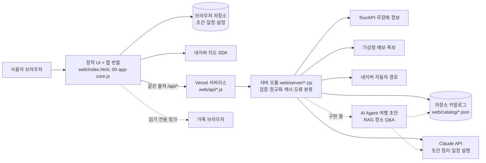

# 함께봄 (HAMKKEBOM)

부모님과 자동차로 여행하는 가족을 위한 지도 중심 여행 계획 서비스입니다. 인기 순위보다 가족의 이동 부담과 조건을 먼저 보고, 접근성 정보는 출처와 함께 보여 줍니다.

- 배포 URL: https://hamkkebom-omega.vercel.app/
- 처음 보신다면: [심사 가이드](docs/JUDGE_GUIDE.md)의 5분 확인 순서

> 이 저장소는 비공개 개발 저장소의 main에서 선별해 만든 공개 평가용 스냅샷입니다. 원본 Git 이력, 운영 설정, 실제 인증정보, 내부 작업 기록은 들어 있지 않습니다. 소스가 있다는 것만으로 실환경 동작이 검증되었다는 뜻은 아니며, 확인 범위는 각 문서에 따로 적었습니다.

## 1. 프로젝트 소개

| 항목 | 내용 |
| --- | --- |
| 대상 사용자 | 부모님(보행 부담·휠체어·보행 보조기 사용 가능)과 자동차로 국내 여행을 계획하는 성인 자녀 |
| 핵심 흐름 | 홈 지도 탐색 → 여행 조건 입력(보행 시간·계단·보조기구·휴식) → 조건 기반 장소 추천 → 일정 작성·편집 → 여행 중 컨디션에 따른 변경안 → 가족 읽기 전용 공유 |
| 서비스 범위 | 장소 탐색은 전국을 목표로, 일정 작성은 서울·경기와 자동차 이동 기준 |
| 형태 | 모바일·PC 브라우저용 웹 앱(설치 없음, 로그인 없음) |

## 2. 해결하려는 문제

부모님과 여행을 준비하는 자녀는 일반 여행 앱에서 다음을 한곳에서 알기 어렵습니다.

- 주차·하차 지점에서 입구까지 계단·경사·거리, 장애인 화장실·엘리베이터·휴식 공간이 있는지와 그 정보의 출처·확인 시점
- 부모님의 연속 보행 가능 시간과 휴식 간격을 반영한 하루 일정
- 당일 컨디션이나 날씨가 바뀌었을 때 남은 일정을 줄이거나 바꾸는 방법
- 일정과 주의사항을 다른 가족에게 읽기 전용으로 알리는 방법

함께봄은 "확인된 정보"와 "정보 없음"을 구분해 보여 주고, 근거가 없는 장소를 적합하다고 단정하지 않는 것을 원칙으로 합니다. 상세는 [요구사항서](docs/REQUIREMENTS.md) §1.

## 3. 팀원 및 역할

| 이름 | 역할 | 담당 영역 |
| --- | --- | --- |
| 남지현 | 팀장, 백엔드 | 서버 API(`web/api`, `web/server`), Vercel 배포·CI·공개 스냅샷 동기화, AI(Claude API) 연동, 코드 통합·병합 |
| 이윤희 | 백엔드 | 서버 API와 외부 데이터 연동(TourAPI·기상청·장소 카탈로그), 추천·일정 계산 로직 |
| 백수현 | 프론트엔드 | 화면 UI(홈·추천 장소·장소 세부·여행 만들기·내 일정), 스타일·반응형·접근성 |

팀 신고 기준 역할이며 Git 커밋 작성자와 1:1로 대응하지 않습니다. 근거는 [CONTRIBUTORS.md](docs/CONTRIBUTORS.md), 커밋 수는 [COMMIT_LOG.md](docs/COMMIT_LOG.md).

## 4. 기술 스택과 선정 이유

| 분야 | 선택 | 고른 이유(요약) |
| --- | --- | --- |
| 프런트엔드 | HTML·CSS·바닐라 JavaScript(빌드 도구 없음, 6개 원본을 이어 붙인 번들) | 의존성 0으로 배포·감사가 단순하고, 기존 단일 HTML 자산을 그대로 나눠 옮길 수 있었음 |
| 서버 | Vercel 서버리스 함수(Node.js, `web/api/*.js` + `web/server/*.cjs`) | 공급자 키를 브라우저에 두지 않으면서 서버 운영 부담이 없음 |
| 생성형 AI | Anthropic Claude Messages API(기본 `claude-haiku-5-5`, 환경변수로 변경 가능) | 구조화 출력(JSON Schema)으로 허용 값만 받기 쉽고, 짧은 추출 작업에 속도·비용이 유리 |
| 공공 데이터 | 한국관광공사 TourAPI·무장애 여행 정보, 기상청 단기예보·특보 | 공식 출처와 확인일을 함께 표시할 수 있음 |
| 지도·경로 | 네이버 지도 JS SDK, 네이버 자동차 경로(서버 플래그) | 국내 지도·주소 품질 |
| 자동화·CI | GitHub Actions + Python 스크립트 | 검사·데이터 정제·공개 동기화를 같은 저장소에서 재현 |
| 품질 | ESLint, Prettier, EditorConfig, Node 내장 테스트 러너, Playwright(CI 브라우저 회귀) | 별도 테스트 프레임워크 없이 실행 |

대안 비교와 상세 이유는 [TECH_STACK.md](docs/TECH_STACK.md).

## 5. 시스템 아키텍처



점선은 아직 병합되지 않은 구현 중 기능입니다. 구성 요소·API·데이터 흐름·배포는 [ARCHITECTURE.md](docs/ARCHITECTURE.md).

## 6. 핵심 AI 활용

| 요소 | 내용 | 상태 |
| --- | --- | --- |
| 자연어 조건 정리 | "엄마 무릎이 안 좋아 계단 적은 곳" 같은 문장을 기존 입력 계약의 허용 값으로 바꿔 미리보기 → 사용자가 적용 | 구현(#119)·모킹 테스트. 운영 활성(2026-11-26 `ANTHROPIC_API_KEY` 등록 후 `/api/ai-assist` 응답 `{"enabled":true}`, 실제 호출 1건 정상 확인) |
| 일정 설명 | 이미 만든 일정 자료만으로 가족에게 보낼 3~6문장 설명. 자료에 없는 숫자·안전 보장 표현은 서버가 제거 | 구현(#119)·모킹 테스트, 운영 활성(실제 호출 품질 확인 안 됨) |
| AI Agent | Claude 도구 호출(`search_places`, `get_place_facts`, `get_weather`, `estimate_travel`)로 여행 초안 작성 | 설계만 함, 운영 미적용([AI_DESIGN.md](AI_DESIGN.md) §9) |
| RAG | 장소 카탈로그·공식 근거를 검색해 Claude 답변과 출처를 함께 제시하는 장소 Q&A | 설계만 함, 운영 미적용([AI_DESIGN.md](AI_DESIGN.md) §9) |
| Long-term Memory | 사용자가 동의한 선호만 기기에 저장해 다음 요청 프롬프트에 사용 | 설계만 함, 운영 미적용([AI_DESIGN.md](AI_DESIGN.md) §9) |
| 프롬프트 설계 | 사용자 문장은 데이터 블록에만 넣고 지시로 취급하지 않음, JSON Schema 구조화 출력, 서버 재검증, 실패 시 AI 영역 숨김 | #119 기준 구현 |

현재 구현 구조는 [AI_INTEGRATION.md](docs/AI_INTEGRATION.md), Agent·RAG·Memory 설계는 [AI_DESIGN.md](docs/AI_DESIGN.md)에 있습니다.

## 7. 자동화 워크플로우 (Python + GitHub Actions)

노코드 자동화 도구(n8n, Zapier, Make 등)는 쓰지 않았습니다. 대신 설정 파일(YAML)로 정의하는 GitHub Actions 워크플로가 Python 스크립트를 실행하는 방식으로 자동화했습니다.

| 워크플로 | 실행 시점 | 하는 일 |
| --- | --- | --- |
| 공개 평가 스냅샷 동기화 | main push(대상 경로 변경 시), 수동 | 허용 목록 파일만 골라 비밀값 패턴 검사 후 공개 저장소로 내보냄(Python 인라인 스크립트) |
| 공중화장실 ETL 회귀 | 관련 PR, 수동 | 공공 CSV 정제 스크립트(`import_public_toilets.py`, 표준 라이브러리만)의 합성 데이터 테스트 |
| 화장실 좌표 수집 | 관련 PR | 공식 좌표 자료를 지도 핀이 아닌 검토 후보로만 가져오는 스크립트 시험 |
| 사진 권리 확인 | 관련 PR, 수동 | 권리가 확인된 사진만 게시되는지 체크섬·출처 검사, 대량 후보 탐색(승인과 분리) |
| 날씨·문서·QA 회귀 | PR, main push | 날씨 모듈 테스트, 정본 문서 해시·링크 검사, 단위 테스트와 Chromium 브라우저 회귀 |

예약 실행(cron)은 없습니다. 이 워크플로 파일들은 비공개 개발 저장소에 있고 공개 스냅샷에는 공개용 CI만 들어갑니다. 상세는 [PROCESS.md](docs/PROCESS.md) §3, [GIT_WORKFLOW.md](docs/GIT_WORKFLOW.md).

## 8. AI 윤리

- **AI 생성 표시**: AI 결과는 사용자가 확인·적용하기 전까지 미리보기로만 보이고, 일정 설명 끝에는 함께봄 일정 자료로 만든 설명이라는 고정 문구가 붙습니다. AI 생성 배지 화면은 구현 중입니다.
- **동의**: 기기에 선호를 저장하는 메모리와 위치 사용은 사용자 동의를 받는 구조로 구현 중입니다. 피드백 폼도 동의 후에만 저장합니다(구현 중).
- **개인정보 최소화**: 건강·보행·보조기구 원문, 정밀 위치, 연락처를 공유 링크·로그·외부 요청에 넣지 않습니다. AI 요청 문장은 함께봄 서버에 저장하지 않습니다.
- **사실 생성 금지**: AI는 접근성 사실을 만들거나 일정을 자동으로 바꾸지 않습니다. 공공자료 안내를 현장 검증처럼 표시하지 않습니다.

## 9. 실행 방법

Node.js 22.13 이상과 Python 3이 필요합니다.

```sh
npm ci && npm run lint && npm test
npm run format:check
python3 scripts/build_core_modules.py --check
```

`npm test`는 공개 테스트 파일을 외부 네트워크를 막은 채 실행합니다. 2026-11-26 팀 실행 기록(자기보고): lint 0 errors, 공개 테스트 407건 중 406 통과·1 건너뜀(실연동 키가 필요한 선택 테스트).

로컬에서 정적 화면만 보려면:

```sh
python3 -m http.server 8000 --directory web
```

http://localhost:8000 을 엽니다. 이 명령은 서버 API를 실행하지 않습니다. 지도는 공개본의 `YOUR_NAVER_MAP_CLIENT_ID`를 본인 허용 도메인의 클라이언트 ID로 바꿔야 합니다. API까지 실행하려면 Vercel 등 호환 런타임에서 `web/`을 배포하고 아래 서버 환경변수를 설정합니다(이름만 적습니다. 값은 저장소에 두지 않습니다).

| 환경변수 이름 | 용도 |
| --- | --- |
| `HB_TOURAPI_KEY`, `DATA_GO_KR_KEY` | 한국관광공사·기상청 공공데이터 |
| `HB_NAVER_DIRECTIONS_ID`, `HB_NAVER_DIRECTIONS_SECRET` | 네이버 자동차 경로 |
| `ANTHROPIC_API_KEY` | Claude API(없으면 AI 영역이 나타나지 않음) |
| `HB_AI_MODEL` | (선택) Claude 모델 변경 |
| `HB_*_ENABLED` | 기능 플래그 |

운영 URL 안정성 측정(읽기 전용 GET, 10초에 1회):

```sh
node scripts/stability_probe.mjs --minutes 35 --interval 10 --out stability-results
```

## 10. 사용자 테스트 결과

**실사용자 5명에게 서비스를 제공하고 피드백을 받았습니다(팀 확인 기준, 2026-11-26).** 피드백은 메신저·대면으로 저장소 밖에서 받았으며, 개인정보 보호를 위해 원문과 참여자 정보는 저장소에 올리지 않습니다. 수집 방법·설문과 반영 절차는 [FEEDBACK.md](docs/FEEDBACK.md)에 적습니다.

## 11. 평가 항목 매핑

| 평가 항목 | 증빙 |
| --- | --- |
| 프로젝트 개요·팀원 역할·기술 스택·실행 방법·결과 | 이 README §1·3·4·9·10 |
| 문제 정의 | §2, [REQUIREMENTS.md](docs/REQUIREMENTS.md) §1 |
| 요구사항서·서비스 아키텍처 | [REQUIREMENTS.md](docs/REQUIREMENTS.md), [ARCHITECTURE.md](docs/ARCHITECTURE.md) |
| AI 활용 방식(프롬프트·Agent·RAG·Memory) | §6, [AI_INTEGRATION.md](docs/AI_INTEGRATION.md), [AI_DESIGN.md](docs/AI_DESIGN.md) |
| 필수 기술 요소 2개 이상 | 자동화 워크플로우(§7, 운영 중), AI Agent·RAG·Long-term Memory(§6, 구현 중) |
| 기술 스택 선정 이유 | [TECH_STACK.md](docs/TECH_STACK.md) |
| 진행 과정 | [PROCESS.md](docs/PROCESS.md) |
| 배포 URL | https://hamkkebom-omega.vercel.app/ |
| 기능 테스트·CI 증거, 요구사항별 검증 | [VERIFICATION.md](docs/VERIFICATION.md), `.github/workflows/ci.yml`, `npm test` |
| 안정성·예외 복구 | [STABILITY.md](docs/STABILITY.md), `scripts/stability_probe.mjs` |
| 실사용자 테스트와 반영 | [FEEDBACK.md](docs/FEEDBACK.md)(실사용자 5명 피드백 수령, 팀 확인 기준) |
| AI 윤리(생성 표시·동의) | §8 |
| 코드 컨벤션 | [CODE_CONVENTION.md](docs/CODE_CONVENTION.md), `eslint.config.mjs`, `.prettierrc.json`, `.editorconfig` |
| Git 버전 관리 기록·브랜치 전략 | [GIT_WORKFLOW.md](docs/GIT_WORKFLOW.md), [COMMIT_LOG.md](docs/COMMIT_LOG.md) |
| 팀원별 기여 | [CONTRIBUTORS.md](docs/CONTRIBUTORS.md) |

## 12. 링크

- 배포: https://hamkkebom-omega.vercel.app/
- [심사 가이드](docs/JUDGE_GUIDE.md) · [요구사항서](docs/REQUIREMENTS.md) · [아키텍처](docs/ARCHITECTURE.md) · [기술 스택](docs/TECH_STACK.md) · [진행 과정](docs/PROCESS.md) · [AI 통합](docs/AI_INTEGRATION.md) · [검증 결과](docs/VERIFICATION.md) · [안정성](docs/STABILITY.md) · [피드백](docs/FEEDBACK.md) · [Git 전략](docs/GIT_WORKFLOW.md) · [커밋 이력](docs/COMMIT_LOG.md) · [기여](docs/CONTRIBUTORS.md) · [코드 컨벤션](docs/CODE_CONVENTION.md)

### 코드 구조

| 경로 | 역할 |
| --- | --- |
| `web/index.html` | 웹 진입점(해시 라우터) |
| `web/assets/core-src/` | 기능별 JavaScript 원본 6개 |
| `web/assets/scripts/` | 생성 번들과 보조 스크립트 |
| `web/assets/styles/` | 화면 스타일 |
| `web/api/`, `web/server/` | API 핸들러와 서버 로직 |
| `web/catalog/` | 장소 데이터와 출처([web/catalog/README.md](web/catalog/README.md)) |
| `scripts/` | 번들 생성·일치 검사, 안정성 측정, 공개 테스트 러너 |
| `tests/` | 공개 스냅샷에서 실행 가능한 단위 테스트 |
| `.github/workflows/ci.yml` | 공개 저장소 CI(lint, format, 번들 일치, 공개 테스트) |
| `docs/` | 제출 문서 |

### 데이터 출처

- 한국관광공사 관광정보·무장애 정보: https://www.data.go.kr/data/15101578/openapi.do, https://www.data.go.kr/data/15101897/openapi.do
- 기상청 단기예보·기상특보: https://www.data.go.kr/data/15084084/openapi.do, https://www.data.go.kr/data/15000415/openapi.do

공공시설 안내는 현장 이동 가능성의 보증이 아닙니다. 실제 인증키나 개인정보를 커밋하지 마세요.

<!-- managed-hamkkebom-evaluation-snapshot-v1 -->
