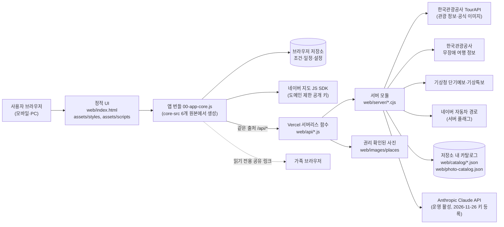
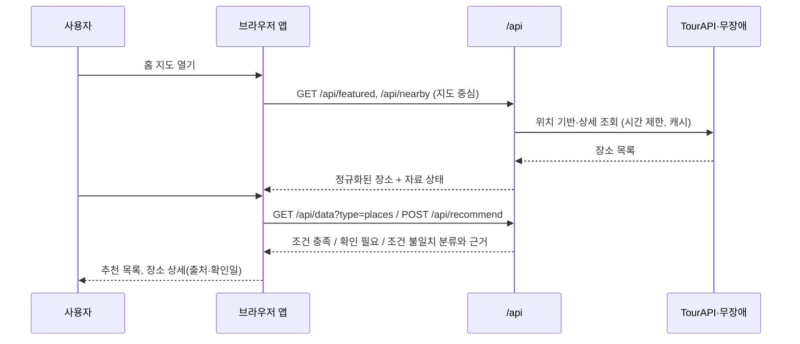
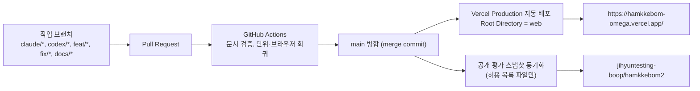

# 함께봄 서비스 아키텍처

기준일: 2026-11-26 (KST). 현재 운영 중인 구조만 적고, 계획 단계인 부분은 "계획"으로 따로 표시합니다.

## 1. 한눈에 보기

생성형 AI(자연어 조건 정리, 일정 설명)는 `/api/ai-assist` → `web/server/ai-assistant.cjs` → Claude API 경로입니다. 2026-11-26 운영에 `ANTHROPIC_API_KEY`를 등록해 `{"enabled":true}`이고, 실제 호출 1건(자연어 조건 정리, 약 1.9초)이 정상 응답했습니다. 키가 없거나 실패하면 화면에서 AI 영역을 숨깁니다. 상세는 [AI_INTEGRATION.md](AI_INTEGRATION.md).

구현 중(미병합, 2026-11-26): AI Agent 여행 초안(Claude 도구 호출 `search_places`·`get_place_facts`·`get_weather`·`estimate_travel`), RAG 장소 Q&A(카탈로그·공식 근거 검색 → 답변과 출처), Long-term Memory(동의한 선호를 기기에만 저장해 프롬프트에 사용), 앱 내 피드백 폼(`#/feedback`). 병합 전이라 이 문서의 구성도·API 표에는 넣지 않았고 병합 후 갱신합니다. 기술 선택 이유는 [TECH_STACK.md](TECH_STACK.md), 진행 과정은 [PROCESS.md](PROCESS.md).

## 2. 구성 요소

| 구성 요소 | 경로 | 역할 |
| --- | --- | --- |
| 진입 HTML | `web/index.html` | 해시 라우터(`#/`, `#/new`, `#/places`, `#/discover`, `#/place/:id`, `#/plan`)를 가진 단일 페이지 |
| 앱 원본 | `web/assets/core-src/00~50-*.js` | 시작, 추천·프로필, 상세·재조정, 일정 엔진·화면, 공유·데이터, 지도·시작 순서의 6개 원본. 한 스크립트 범위를 공유하므로 따로 불러오지 않음 |
| 앱 번들 | `web/assets/scripts/00-app-core.js` | 위 6개를 `manifest.json` 순서대로 이어 붙인 결과. `scripts/build_core_modules.py --check`가 일치를 검사 |
| 보조 스크립트 | `web/assets/scripts/01~04-*.js`, `web/assets/components/rich-place-detail.js` | 계절 테마, 장소 사진, 접근성 안내, 일러스트, 상세 시설 표시 |
| 스타일 | `web/assets/styles/00~15-*.css` | 공통·테마·화면별 스타일 |
| API 핸들러 | `web/api/*.js` | Vercel 서버리스 함수. 대부분 한두 줄로 서버 모듈을 호출 |
| 서버 모듈 | `web/server/*.cjs` | 입력 검증, 외부 API 호출, 응답 정규화, 캐시, 오류 분류 |
| 카탈로그 | `web/catalog/*.json` | 서울·경기 장소 스냅샷, 접근성 관찰 기록, 장소 세부 공식정보 22곳(`place-details.v1.json`·`daechi-area-details.v1.json`, 항목마다 출처 URL과 확인일), 보강 자료(출처는 `web/catalog/README.md`) |
| 이전 도구 | `web/migration.html` | 이전 운영 사이트 사용자의 브라우저 저장 자료를 백업·복원 |

## 3. API

| 경로 | 메서드 | 서버 모듈 | 외부 자료 | 실패 시 |
| --- | --- | --- | --- | --- |
| `/api/data?type=places` | GET | `place-catalog.cjs` | TourAPI | 키가 없으면 저장소 스냅샷, 공급자 오류는 오류 코드로 응답 |
| `/api/data?type=weather`, `/api/weather` | GET | `weather-provider.cjs`, `weather-alerts.cjs` | 기상청 | 400/429/503/504/502로 원인 구분 |
| `/api/nearby` (`/api/nearby.js`) | GET | `place-catalog.cjs` | TourAPI 위치 기반 | 실패한 유형을 응답에 표시, 캐시하지 않음 |
| `/api/featured` (`/api/featured.js`) | GET | `featured-catalog.cjs` | TourAPI 상세 | 실패 시 짧은 캐시(1시간)로 반복 호출 제한 |
| `/api/photo` | GET | `tour-official-image.cjs` | 권리 확인 사진, TourAPI 공식 이미지 | 키가 없으면 사진 없음 처리 |
| `/api/toilets` | GET | `public-toilets.cjs` | 좌표 검수된 공중화장실 시범 자료 | 좌표 미확인 자료는 제외 |
| `/api/rich-tour` | GET | `rich-tour.cjs`, `curated-place-details.cjs` | TourAPI 상세·무장애, 공식 출처 세부정보 카탈로그 | 실시간 조회는 운영 플래그로 끔(검색은 503 `rich_tour_disabled`). 상세는 카탈로그에 있는 22곳을 공식 출처 정보로 응답(2026-11-26 확인) |
| `/api/recommend` | POST | `travel.cjs` | 장소 카탈로그 | 조건 검증 실패 400 |
| `/api/travel-times`, `/api/trip-endpoints` | POST | `travel.cjs`, `naver-directions.cjs` | 네이버 자동차 경로 | 응답이 없으면 "예상" 이동시간으로 표시 |
| `/api/ai-assist` | GET(상태), POST(parse·summary) | `ai-assistant.cjs` | Anthropic Claude | 키 없음·실패·시간 초과·한도는 모두 `unavailable`, 화면은 AI 영역을 숨기고 수동 입력 유지 |

서버가 쓰는 환경변수는 이름만 적습니다: `HB_TOURAPI_KEY`, `DATA_GO_KR_KEY`, `HB_NAVER_DIRECTIONS_ID`, `HB_NAVER_DIRECTIONS_SECRET`, `ANTHROPIC_API_KEY`, `HB_AI_MODEL`, 기능 플래그 `HB_*_ENABLED`. 값은 저장소와 공개 스냅샷에 포함하지 않습니다.

## 4. 데이터 흐름

### 4.1 탐색 → 조건 → 추천

### 4.2 일정 → 여행 중 → 공유

1. 사용자가 장소를 담으면 브라우저 일정 엔진(`30-itinerary-engine-and-ui.js`)이 방문 순서·도착·체류·식사·휴식을 만듭니다.
2. 이동시간은 `POST /api/travel-times`로 요청하고, 실제 경로 응답이 없으면 "예상"으로 표시합니다.
3. 날씨(`/api/data?type=weather`, `/api/weather?type=alerts`)를 받아 비·특보 시 실내 장소와 시간대를 먼저 제안합니다.
4. 여행 중 사용자가 컨디션을 고르면 변경안을 만들고, 원안과 비교해 적용·취소·되돌리기를 합니다. 완료·필수·예약 일정은 바꾸지 않습니다.
5. 공유 링크는 공개해도 되는 일정 요약만 URL에 담아 만듭니다. 받는 쪽은 읽기 전용 지도를 봅니다.

일정·조건은 현재 사용자 브라우저에만 저장됩니다. 서버 데이터베이스, 로그인, 공유 토큰 만료·회수는 정책 결정 전이라 구현하지 않았습니다(계획).

## 5. 배포

- Vercel 프로젝트의 루트는 `web/`이며, `web/vercel.json`이 main(및 통합 미리보기 브랜치)만 자동 배포하도록 제한합니다.
- 문제가 생기면 Vercel에서 이전 정상 배포로 되돌리고, 원인 커밋은 revert PR로 고칩니다.
- 상세 브랜치 규칙은 [GIT_WORKFLOW.md](GIT_WORKFLOW.md)에 있습니다.

## 6. 공개 평가 스냅샷과의 관계

- 개발 정본은 비공개 저장소 `emailnamjihyun-afk/hamkkebom`의 main입니다.
- 공개 저장소 `jihyuntesting-boop/hamkkebom2`는 main 병합 때 GitHub Actions(`evaluation-public-sync.yml`)가 만드는 스냅샷이며 직접 수정하지 않습니다.
- 스냅샷에는 허용 목록에 있는 `web/` 파일, 빌드 검사 스크립트, 안정성 측정 스크립트, lint·format 설정과 `package.json`·lock, 공개 테스트 러너와 오프라인 공개 테스트 51개, 공개용 CI(`.github/workflows/ci.yml`), 이 제출 문서(`docs/`)와 README만 들어갑니다. 새 `web/` 파일이 허용 목록에 없으면 동기화가 멈춥니다.
- 내보내기 전에 비밀값 패턴을 검사하고, 지도 공개 키는 자리표시자(`YOUR_NAVER_MAP_CLIENT_ID`)로 바꾸며, 권리 검토 전 사진 목록은 비웁니다. 강제 push는 하지 않습니다.
- 그래서 공개 스냅샷에는 원본 Git 이력, 내부 작업 기록, 운영 설정, 일부 테스트·자료 파일이 없습니다. 실행 증거는 [VERIFICATION.md](VERIFICATION.md)에 옮겨 적었습니다.

## 7. 알려진 한계

| 항목 | 현재 |
| --- | --- |
| 서버 저장·인증 | 없음. 일정은 브라우저별 저장 |
| 공유 보안 | URL에 담은 읽기 전용 요약. 만료·회수 불가 |
| 전국 상세 조회 | 실시간 조회는 운영 플래그 꺼짐. 공식 출처 카탈로그에 있는 22곳만 세부정보 표시 |
| 접근성 자료 | 일부 장소만 공공자료 근거가 있음. 현장 검증 아님 |
| 사진 | 권리 확인 사진 2건과 같은 장소 ID의 관광공사 공식 이미지만 사용 |
| 자동차 경로 | 서버 플래그로 켜고 끔. 운영 키 등록·실제 경로 응답은 확인 안 됨 |
| 생성형 AI | 운영 활성(실제 호출 1건 확인). 응답 품질·비용의 체계적 평가는 확인 안 됨 |
