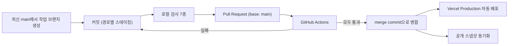

# 함께봄 Git 저장소와 브랜치 전략

기준일: 2026-11-26 (KST).

## 1. 원격 저장소와 배포 주소

| 구분 | 주소 | 공개 여부 | 역할 |
| --- | --- | --- | --- |
| 개발 정본 | https://github.com/emailnamjihyun-afk/hamkkebom | 비공개 | 모든 개발·문서·테스트·CI. 기본 브랜치 `main` |
| 공개 평가 스냅샷 | https://github.com/jihyuntesting-boop/hamkkebom2 | 공개 | 정본 main 병합 시 자동 생성되는 선별 스냅샷. 직접 수정하지 않음 |
| 운영 서비스 | https://hamkkebom-omega.vercel.app/ | 공개 | 정본 main의 `web/`을 Vercel이 자동 배포 |

개발 정본은 비공개라 평가자가 PR·Actions 링크를 직접 열 수 없을 수 있습니다. 그래서 실행 결과와 이력 요약을 [VERIFICATION.md](VERIFICATION.md)와 [COMMIT_LOG.md](COMMIT_LOG.md)에 옮겨 적었습니다.

## 2. 브랜치 전략

| 브랜치 | 용도 | 규칙 |
| --- | --- | --- |
| `main` | 배포 브랜치 | 직접 push하지 않고 PR 병합으로만 바꿈. 병합되면 운영 배포와 공개 스냅샷 동기화가 실행됨 |
| `claude/*`, `codex/*` | AI 코딩 에이전트 작업 브랜치 | 작업 하나당 브랜치 하나. 이름에 작업 내용과 날짜를 넣음(예: `claude/submission-docs-20261126`) |
| `feat/*` | 기능 개발 | 최신 main에서 분기 |
| `fix/*` | 버그 수정 | 최신 main에서 분기 |
| `docs/*` | 문서만 바꾸는 작업 | 최신 main에서 분기 |
| `archive/*` | 과거 상태 보존 | 수정하지 않음 |

2026-11-26 기준 원격 브랜치 이름 분포(작업 브랜치는 병합 후에도 지우지 않고 남겨 둠): `codex/*` 42, `feat/*` 30, `claude/*` 21, `fix/*` 5, `docs/*` 4, 기타(`archive/*`, `chore/*` 등) 9.

## 3. 작업 흐름



1. 최신 `origin/main`에서 브랜치를 만듭니다.
2. 커밋 전에 로컬 검사를 실행합니다.
   ```sh
   python scripts/verify_context.py
   python scripts/build_core_modules.py --check
   python scripts/verify_source_split.py --parity
   python scripts/check_web_snapshot.py
   python scripts/verify_api_contract.py
   node --check web/assets/scripts/00-app-core.js
   python scripts/run_unit_regression.py
   ```
3. PR을 열면 GitHub Actions가 실행됩니다.
   - `Verify official HAMKKEBOM docs`: 정본 문서 해시·링크·웹 스냅샷 검사(모든 PR과 main push)
   - `QA-01 regression`: Node 단위 테스트 전체와 Chromium 브라우저 회귀(320/375/768/1280px)
   - 경로별 추가 검사: 날씨 회귀, 사진 브라우저 검사, 화장실 자료 검사 등
4. 검사가 모두 통과하고 PR head가 바뀌지 않았을 때만 merge commit으로 병합합니다. 병합 순서가 정해진 여러 PR은 앞 PR 병합 뒤 최신 main을 merge해 다시 검사합니다.
5. 병합 뒤 Vercel 배포와 공개 스냅샷 동기화 결과를 확인합니다.

## 4. 규칙

- force push, `main` 직접 push, 다른 사람 PR 브랜치 덮어쓰기를 하지 않습니다.
- 충돌은 최신 main을 작업 브랜치에 merge해서 풉니다(병합 기록을 남김).
- 생성 번들 `web/assets/scripts/00-app-core.js`는 직접 고치지 않고 `web/assets/core-src/`를 고친 뒤 `python scripts/build_core_modules.py`로 다시 만듭니다.
- API 키 등 비밀값은 커밋하지 않습니다. `.gitignore`가 `.env*`, 인증서·키 파일을 제외합니다.
- 커밋 메시지에는 무엇을 왜 바꿨는지와 관련 기능 ID를 적습니다(예: `fix(places): ... (REC-04, UI-03)`).
- GitHub 브랜치 보호 규칙은 설정되어 있지 않습니다(2026-11-26 API 조회 결과 404). 위 규칙은 팀 운영 규칙과 CI로 지킵니다.

## 5. PR 규칙

PR 본문에는 다음을 적습니다.

- 바뀐 것과 이유, 관련 요구사항 ID
- 직접 실행한 검사와 결과(통과 수는 실행자 기록)
- 확인하지 못한 것(실기기, 운영 화면, 실제 외부 API 응답 등)
- 되돌리는 방법(대부분 해당 병합 커밋 revert)

## 6. 공개 스냅샷 동기화

- 워크플로: `.github/workflows/evaluation-public-sync.yml`
- 실행 시점: 정본 main에 `web/**`, 빌드 검사 스크립트, 제출 문서(`docs/submission/**`), 안정성 측정 스크립트, lint·format 설정과 `package*.json`, 공개 테스트 러너, `tests/*.test.cjs`, 공개 CI 원본(`public-ci/ci.yml`), 워크플로 자체가 바뀐 커밋이 push될 때와 수동 실행 시
- 내보내는 파일: 명시적 허용 목록만. 새 `web/` 경로나 `docs/submission/`의 목록 밖 파일이 있으면 동기화가 실패하고 사람이 검토합니다. 공개 테스트 목록이 `scripts/run_public_tests.mjs`의 목록과 다르면 역시 실패합니다.
- 공개 CI: 정본의 `public-ci/ci.yml`을 공개 저장소의 `.github/workflows/ci.yml`로 복사합니다. 정본에서는 실행되지 않고, 공개 저장소에서 lint·format·번들 일치·공개 테스트를 실행합니다.
- 안전장치: 비밀값 패턴 검사, 지도 공개 키 자리표시자 치환, 권리 검토 전 사진 목록 비우기, 대상 저장소의 관리 표식 확인, 스냅샷에 없는 파일이 대상에 있으면 중단, force push 없음
- 대상 저장소에는 원본 Git 이력을 보내지 않고, 매번 "Update public evaluation source snapshot" 커밋 하나를 추가합니다.
